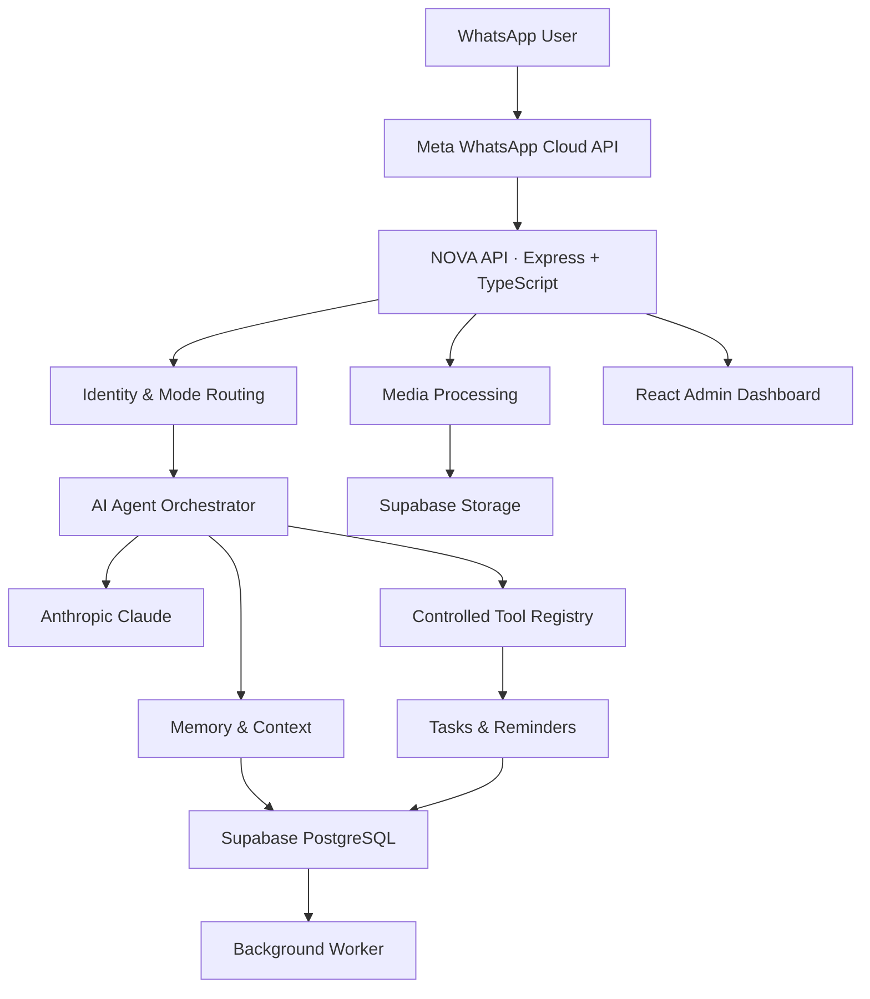

# ✦ NOVA AI

<p align="center">

  

</p>

<p align="center">
  **A Claude-powered WhatsApp AI Agent**
  <br />
  Personal Intelligence · Business Support · Persistent Memory · Smart Automation
</p>

<p align="center">
  
  
  
  
</p>

<p align="center">
  
  
  
  
</p>

---

## ◈ The Vision

NOVA AI is more than a conventional chatbot.

It is an intelligent WhatsApp assistant designed to combine personal productivity and business support through one AI-powered platform.

Powered by Anthropic Claude, NOVA understands conversations, maintains persistent context, processes documents, manages tasks and schedules reminders.

**One AI. Two operating modes. A connected experience.**

<details>
<summary><strong>Explore NOVA AI's capabilities</strong></summary>

- Natural conversations in English, Urdu and Roman Urdu.
- Persistent, user-controlled memory.
- Personal and business conversation isolation.
- AI-powered task and note management.
- Intelligent reminders and scheduling.
- Voice, image and document understanding.
- Secure WhatsApp messaging.
- Web-based administration dashboard.

</details>

## ◈ Core Capabilities

<table>
<tr>
<td width="50%">

### 🧠 AI Intelligence

- Claude-powered reasoning
- Context-aware conversations
- Conversation summaries
- Persistent memory
- Structured tool calling

</td>
<td width="50%">

### 💬 WhatsApp Integration

- Official Cloud API
- Incoming messages
- Outgoing replies
- Media processing
- Delivery tracking

</td>
</tr>
<tr>
<td width="50%">

### ⚡ Productivity

- Task management
- Notes and memory
- One-time reminders
- Recurring schedules
- Background job processing

</td>
<td width="50%">

### 📁 Multimodal Understanding

- Image analysis
- PDF understanding
- DOCX extraction
- XLSX extraction
- Voice transcription
- Optional voice responses

</td>
</tr>
</table>

## ◈ Two Intelligent Modes

### Personal Mode

A private assistant for the verified owner.

- Personal conversations
- Private long-term memory
- Notes and tasks
- Personal reminders
- Private document management
- Owner-authorized actions

### Business Mode

An intelligent assistant for customer interactions.

- Automated customer support
- Business FAQs
- Business information retrieval
- Customer contact collection
- Document-based assistance
- Business conversation management

> **Privacy by design:** Personal and business contexts are separated. Unknown WhatsApp senders cannot access private owner information.

## ◈ System Architecture



## ◈ Technology Stack

| Layer | Technology |
|---|---|
| AI Engine | Anthropic Claude |
| Backend | Node.js, Express 5 |
| Language | TypeScript |
| Frontend | React 19, Vite |
| Styling | Tailwind CSS |
| Database | Supabase PostgreSQL |
| Storage | Supabase Storage |
| Validation | Zod |
| Logging | Pino |
| Messaging | Official WhatsApp Cloud API |
| Deployment | Railway |

## ◈ Project Structure

```text
NOVA-AI/
│
├── apps/
│   ├── api/
│   │   ├── src/
│   │   │   ├── agent/
│   │   │   ├── integrations/
│   │   │   ├── memory/
│   │   │   ├── media/
│   │   │   ├── tools/
│   │   │   ├── scheduler/
│   │   │   ├── queue/
│   │   │   └── services/
│   │   └── test/
│   │
│   └── web/
│       └── src/
│           ├── components/
│           ├── pages/
│           ├── layouts/
│           └── services/
│
├── packages/
│   └── shared/
│
├── supabase/
│   └── migrations/
│
├── scripts/
├── Dockerfile
├── README.md
├── DEVELOPMENT_STATUS.md
└── VERIFICATION_REPORT.md
```

## ◈ Getting Started

### Requirements

- Node.js 22+
- npm
- Supabase project
- Anthropic API account

### 1. Clone the repository

```bash
git clone YOUR_REPOSITORY_URL
cd nova-ai
```

### 2. Install dependencies

```bash
npm ci
```

### 3. Configure environment

```bash
cp .env.example .env
```

Open `.env` and configure your credentials locally.

Never commit `.env` or expose private API keys.

### 4. Configure Supabase

1. Create a Supabase project.
2. Open the SQL Editor.
3. Execute `supabase/migrations/001_nova.sql`.
4. Configure the required environment variables.

```env
SUPABASE_URL=
SUPABASE_SERVICE_ROLE_KEY=
```

The service-role key must remain server-side.

### 5. Configure Claude

Create an API key through the Anthropic Console.

```env
ANTHROPIC_API_KEY=
CLAUDE_MODEL=claude-sonnet-4-5
```

The model identifier is configurable and must be available to your Anthropic account.

### 6. Start NOVA AI

```bash
npm run dev
```

Default development endpoints:

| Service | Address |
|---|---|
| API | http://localhost:3001 |
| Dashboard | http://localhost:5173 |
| Health | http://localhost:3001/health |

Start the background worker separately:

```bash
npm run worker
```

## ◈ WhatsApp Configuration

NOVA AI uses the official Meta WhatsApp Cloud API.

Required environment variables:

```env
WHATSAPP_ACCESS_TOKEN=
WHATSAPP_PHONE_NUMBER_ID=
WHATSAPP_VERIFY_TOKEN=
META_APP_SECRET=
WHATSAPP_API_VERSION=v23.0
```

Configure your Meta webhook:

```text
https://YOUR_DOMAIN/api/webhooks/whatsapp
```

Subscribe to the `messages` webhook event.

**Important:** Meta account configuration, production access tokens, webhook approval and message templates must be configured by the account owner.

### WhatsApp Service Window

Free-form outgoing messages are subject to WhatsApp's 24-hour customer-service window. Approved templates are required for applicable business-initiated messages outside that window.

## ◈ Security Architecture

Security is a core part of NOVA AI.

- Verified owner identity.
- Personal/business data isolation.
- Supabase Row Level Security.
- Server-side service-role credentials.
- Webhook HMAC signature verification.
- Zod input validation.
- Rate limiting.
- Secure media downloads.
- Private document storage.
- Explicit confirmation for consequential AI actions.
- Audit logs and job tracking.

NOVA does not provide Claude unrestricted shell access, arbitrary SQL execution or unrestricted external actions.

## ◈ Verification

Run the following commands:

```bash
npm run typecheck
npm test
npm run build
npm audit --audit-level=moderate
npm run test:browser
npm run format:check
```

These checks cover local application behavior. Hosted Supabase, live Claude requests, WhatsApp delivery and authenticated production workflows require external configuration and acceptance testing.

## ◈ Deployment

NOVA AI includes Railway deployment preparation.

The intended deployment consists of:

| Service | Responsibility |
|---|---|
| API / Web | Express API and dashboard |
| Worker | Background jobs and reminders |
| Supabase | Database and private storage |

Docker image builds and live production deployment must be tested separately before launch.

## ◈ Current Development Status

| Phase | Description | Status |
|---|---|---|
| 01 | Project Foundation | Implemented |
| 02 | Claude Integration | Implemented |
| 03 | Database & Persistence | Implemented |
| 04 | WhatsApp Integration | Implemented in workspace; live verification pending |
| 05 | Agent & Tool Execution | Implemented in workspace; live verification pending |
| 06 | Memory & Mode Isolation | Implemented in workspace; live verification pending |
| 07 | Media & Documents | Implemented in workspace; provider verification pending |
| 08 | Tasks & Reminders | Implemented in workspace; live verification pending |
| 09 | Admin Dashboard | Implemented in workspace; hosted workflow verification pending |
| 10 | Security & Deployment | Hardening and deployment verification pending |

**Current release status: Implemented application with local verification — not production-certified.**

For detailed evidence, limitations and remaining work, see:

- `DEVELOPMENT_STATUS.md`
- `VERIFICATION_REPORT.md`

## ◈ Important Limitations

Before public production use:

- Complete hosted Supabase and provider acceptance tests.
- Configure Meta templates and owner verification.
- Add malware scanning and isolated document parsing.
- Establish monitoring, backups and retention policies.
- Configure spending limits and operational alerts.
- Test worker recovery and external message delivery.

Outbound delivery is at-least-once, not guaranteed exactly-once. Provider configuration alone does not establish live integration health.

## ◈ Project Philosophy

> Build useful intelligence, not another chatbot.
>
> Keep private data private.
>
> Automate responsibly.
>
> Make every interaction meaningful.

---

<p align="center">

  **NOVA AI**

  <br />

  *Intelligence that works where you communicate.*

  <br /><br />

  
  

</p>
